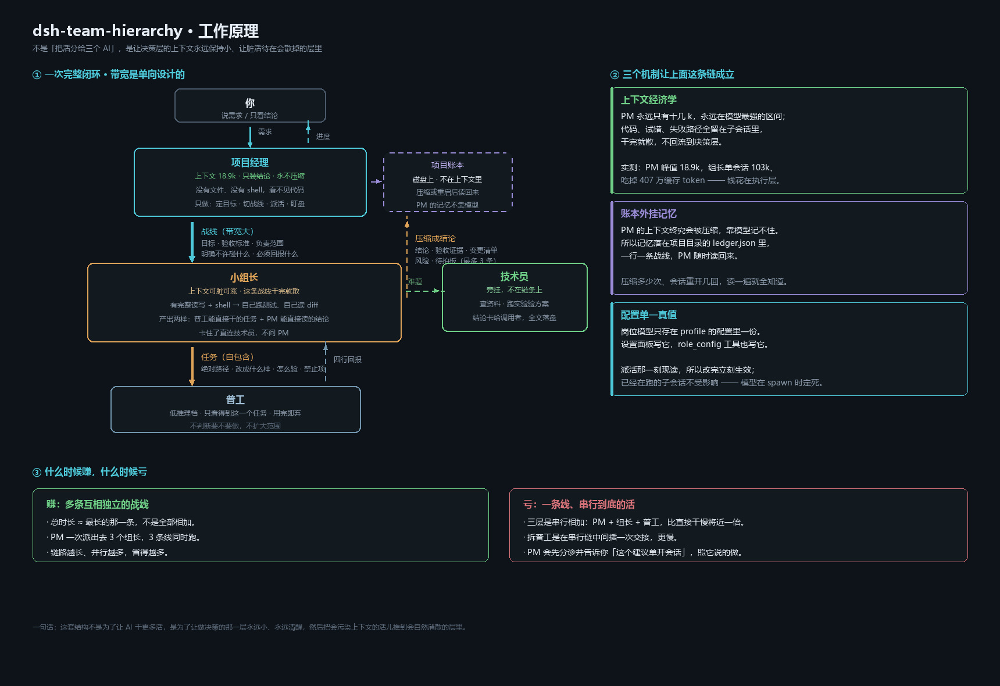
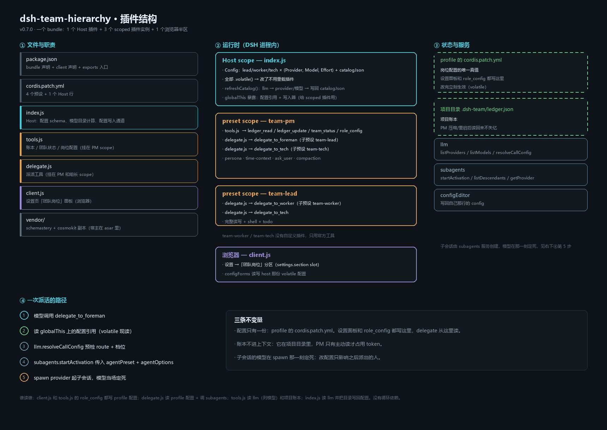

# 三层智能体团队 + 技术员

一个 DSH 插件包：装好之后，新建会话时多出四个预设，岗位模型在设置里配。

仓库：<https://github.com/cl145FPV/dsh-team-hierarchy> · 许可 MIT

## 安装

```bat
dsh plugin --profile desktop add github:cl145FPV/dsh-team-hierarchy
```

装完**完全退出 DSH** 再启动（Host 半区有代码，不重启不加载）。

环境要求、更新方式、验证步骤见 [INSTALL.md](INSTALL.md)。

## 四个岗位

| 预设 | 干什么 | 工具 |
| --- | --- | --- |
| **项目经理** | 只和你对话。定目标、切战线、派组长、叫技术员、管账本、盯进度 | 派战线 / 叫技术员 / 看团队 / 读账本 / 写账本 / 改岗位配置 / 发消息 / 打断 / 问用户 |
| **小组长** | 接一条战线。摸清现状、拆成普工任务、自己验收、压成结论报回去 | 完整读写 + shell + 派普工 + 叫技术员 |
| **普工** | 拿一条拆到位的任务直接干完，四行回报 | 读写 + shell + 后台任务 |
| **技术员** | 翻研究库、搜开源、跑实验验证方案，结论卡 + 全文落盘 | 联网 + 只读项目 + shell |
| **审查员** | 只读，先假设有 bug 再找证据。按六项清单出问题表格，不改代码 | 只读 + shell（跑测试）+ 搜索 |

层级：`PM(0) → 小组长(1) → 普工(2)`，`小组长(1) → 技术员(2)`，`PM(0) → 技术员(1)`，`小组长(1) → 审查员(2)`，`PM(0) → 审查员(1)`。

## 怎么用

1. 新建会话，预设选「项目经理」
2. 像对一个人那样说需求
3. 需要配模型时去 **设置 → 团队岗位**

## 岗位模型配置

设置 →「团队岗位」，三个岗位各配 provider / 模型 / 推理档位。留空 = 继承上级。

- provider 和模型必须**同时填或同时留空**
- 保存后下一次派活生效，已经在跑的子会话不受影响
- provider 列表由 Host 从本机的 `llm` 服务实时算出，写进插件配置的 `catalogJson` 字段；设置页只读不写
- 同一个配置也能让 PM 用 `role_config` 工具改——**两个入口写的是同一份配置**

推理档位：`off` 机械执行 / `low` 套路活 / `high` 需要判断 / `max` 极难。

## 工具

| 工具 | 谁用 | 作用 |
| --- | --- | --- |
| `delegate_to_foreman` | PM | 派战线给小组长 |
| `delegate_to_tech` | PM / 小组长 | 叫技术员解难题 |
| `delegate_to_worker` | 小组长 | 派任务给普工 |
| `delegate_to_reviewer` | PM / 小组长 | 派审查员挑 bug |
| `ledger_read` / `ledger_update` | PM | 项目账本（磁盘上，压缩后读回来） |
| `team_status` | PM | 看整棵树，结论行直说「可以收工 / 不能收工」 |
| `role_config` | PM | 查 / 改岗位模型配置 |

`ledger_update` 支持 `lanes` 数组一次写多条；`role_config` 支持 `assignments` 数组一次改多个岗位。

## 设计约束（不是 bug）

- **PM 没有文件权限**，看不见代码。实测上下文峰值 18.9k，所以永远在最强的区间。
- **成本中心是组长不是 PM**。实测组长一个会话吃掉 407 万缓存 token，PM 只有 12.5 万。所以给组长拆普工不只是省时间，是省 token。
- **串行任务别走三层**。三层只在并行时赚；单线程任务它必然亏将近一倍。PM 会先分诊并告诉你。
- **组长必须自己验收**，不许叫技术员来验。技术员解的是「不知道怎么做」，不是「帮我确认做对了没」。
- **组长跑久了要换人**。上下文脏了判断力会掉，PM 应该在 20 分钟或出现绕圈信号时停掉换新组长。

## 标题栏团队状态

会话标题栏有一个胶囊，按岗位一字排开显示当前团队：

```
● 小组长 2/2    ● 技术员 1/1    ○ 审查员 0/1
```

绿点 = 该岗位有人在下，`2/2` = 在跑数/总数。没人的岗位不占位。

点它打开详情面板（挂全局浮层，不受标题栏裁切）：每个下级一行，显示岗位标签、任务标题、跑着还是空闲。

> 岗位标签靠派活时记的进程内映射。重启前派出去的旧会话会显示「未登记」。

## 复用下级

`delegate_*` 工具都有 `reuse` 参数，填一个**已存在下级的显示标题**，任务会追加给那个会话而不是新开：

- 同战线接着干 → 复用（它记得上一轮改了什么，前缀缓存也还在）
- 换战线 → 新开（会带着上一条战线的上下文污染）
- 跑超 20 分钟 / 报过错 → 换新

**注意**：`reuse` 要传的是**显示标题**（`team_status` 里那一整串），不是内部短名。

## 自主推进（默认关闭）

PM 默认是被动的：只在有用户输入、或者下级完成回来时才动。

只有当用户明确说「自主推进」「你不用问我」这类话，PM 才会用 `create_goal` 立目标持续往下推。立目标时必须：

- 写成可判定完成的形式（「三条战线验收全过」而不是「把项目做好」）
- 设 `max_goal_rounds` 轮次上限
- 每轮往账本写一行

遇到要删文件/改系统/推翻重做/连续两轮没进展时，会停下等人。

## 已知限制

- 派活前会做 route 预检，模型不支持某档位时直接报错，不会让子会话启动即死。
- 子会话的模型在启动时定死，改配置不影响已经在跑的那些。
- 普工/技术员挂了 `tool-subagent-control` 只为了 `send_message` 回报，另外两个工具（`list_agents` / `interrupt_agent`）对它们是空转——这三个工具拆不开。
- `catalogJson` 每 60 秒重算一次；如果 `listModels` 顺序不稳定会重复写盘（低风险）。

## 工作原理



## 插件结构



## 文件

| 文件 | 作用 |
| --- | --- |
| `index.js` | Host 半区：岗位配置 schema、模型目录计算、`role_config` 的写入通道 |
| `tools.js` | 账本 / 团队状态 / 岗位配置工具（挂在 PM 预设） |
| `delegate.js` | 派活工具（挂在 PM 和组长预设），按配置决定子会话模型 |
| `client.js` | 设置页「团队岗位」面板 |
| `cordis.patch.yml` | 四个预设声明 |
| `vendor/` | schemastery + cosmokit 副本（宿主在 app.asar 里，第三方插件 import 不到） |
| `docs/` | 设计阶段的结构图与生成脚本 |
